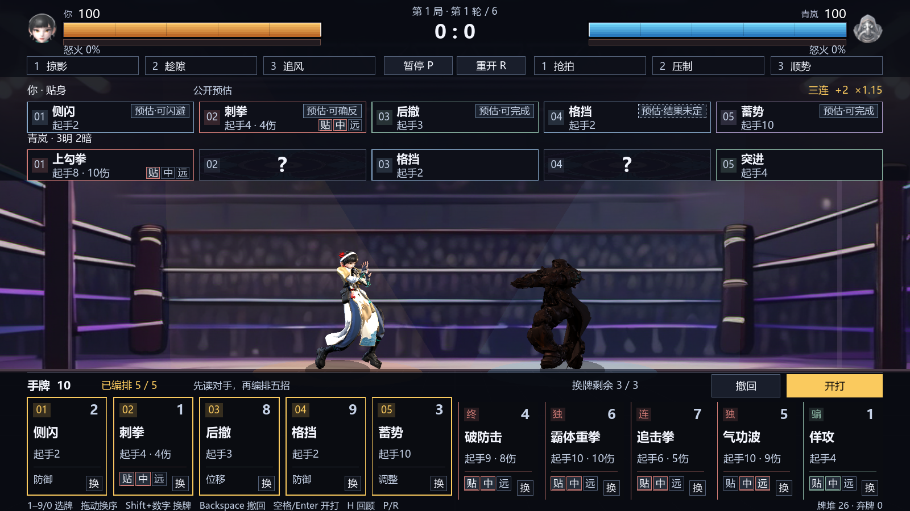
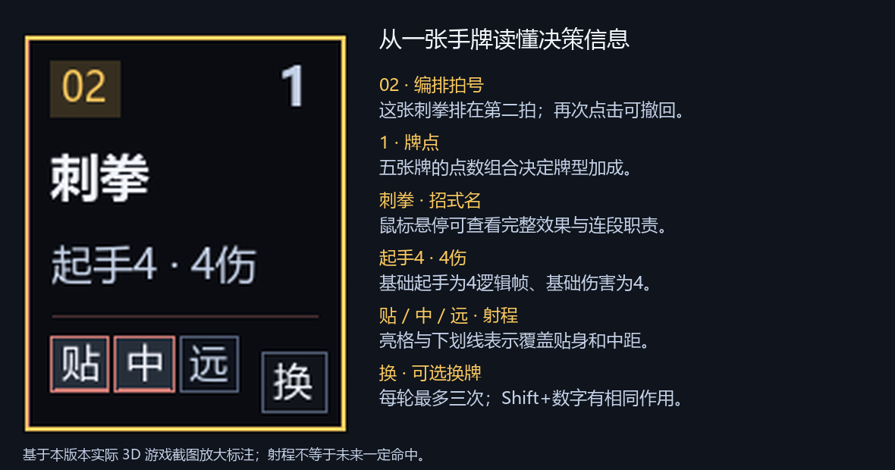
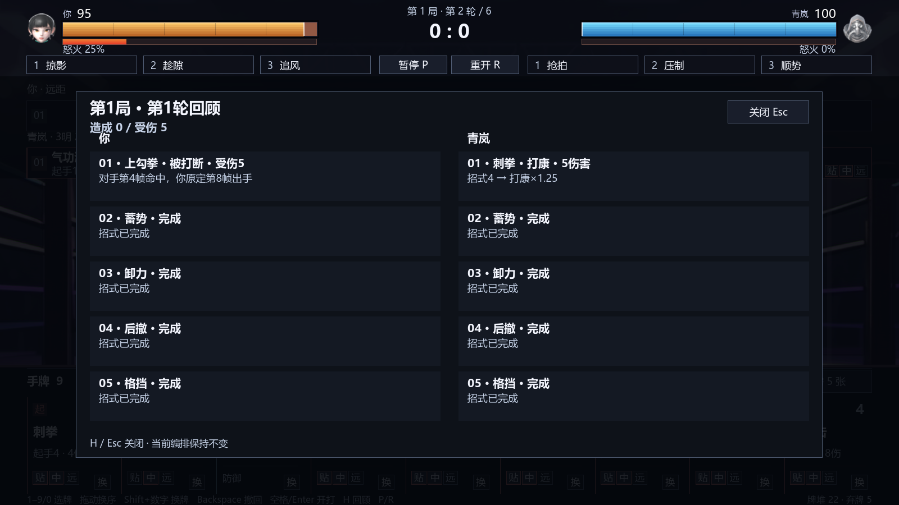

# 牌拳 / CARD BOXER

默认是回合制卡牌格斗：**牌序决定攻防，牌型和战术天赋放大收益。** 从8张手牌一次编排5张动作，提前读敌方三张明牌，用闪避确反、抢起手打康、投技和佯攻破解防守。敌人五张牌先锁定，再随机遮住两张。

[Windows独立游戏下载](https://github.com/tutict/CardBoxer/releases/latest) · [图文入门](../README.md)



## 启动与操作

- `play.bat`：战术模式、原生 3D 角色；仓库根目录也有相同入口。
- `play-classic.bat`：3D 传统三张比牌。
- `play-realtime.bat`：3D 实时卡牌格斗。

Godot 4.5 或更新的 Godot 4 / GL Compatibility，也可直接打开 `project.godot`。所有模式统一使用双方原生 3D 模型，2D 人物版及专用动作表已删除。启动默认最大化；战术界面使用1600×900画布，按窗口等比缩放。`CARD_BOXER_BATTLE_MODE=tactical|taikou|realtime` 选模式。

启动器支持游戏目录中的 `godot.exe`、PATH、已有的 Godot 安装目录，以及 `CARD_BOXER_GODOT` 指定的完整引擎路径。首次启动会自动导入素材。错误日志保存在临时目录下的 `CardBoxerLogs`，启动失败时窗口会显示原因并等待按键。

| 操作 | 作用 |
|---|---|
| 鼠标点击 / `1–9` | 选手牌；开局 `1–6` 选天赋 |
| `0` | 第十张手牌 |
| `Backspace` | 撤销最后一张 |
| 手牌“换”按钮 / Shift+数字 | 可选换一张，每轮最多三次 |
| 点击已编排的牌槽 | 撤回该张，其余顺序保留 |
| 拖动我方牌槽 | 改变出招顺序；拖到空槽移至末尾，拖出计划区取消 |
| 空格 / Enter / 确认按钮 | 确认天赋或确认五张开打 |
| `P` / 暂停按钮 | 暂停、继续 |
| `R` / 重开按钮 | 重新构筑一场 |
| `H` / 回顾按钮 | 编排阶段查看上轮双方五拍结果；`Esc` / 关闭按钮返回原计划 |
| 悬停手牌、明牌或天赋 / 数字键选牌 | 查看完整说明；暗牌不泄露招式 |
| `Tab` | 原有角色档案 |

## 一场怎样打

1. 从随机提供的六项战术天赋中选择三项，选择次序就是触发次序。再次点击取消，退格撤销末选。
2. 每轮直接进入编排页。对手已锁定五招，显示三张实际牌名、起手和伤害，随机两张为暗牌。编排或换牌不会重抽对手的牌和暗牌位置。
3. 从8张手牌按顺序选5张，空格开打并揭开暗牌，双方逐拍交锋。换牌是同页可选操作；换掉已编排的手牌只撤回该张。
4. 每拍的收招与受击硬直差形成下一拍延迟，最多12帧。攻击赶上对方等待窗口且距离满足时是确反，加伤3；抢中已经开始的攻击起手是打康，伤害×1.25，再按打断力决定是否取消对方攻击。
5. 出过的牌进入弃牌堆，轮末补手牌。天赋可令下一轮多摸，最多10张；牌堆耗尽后洗回弃牌。

三局两胜，整场最多三局；每局100HP、最多六轮，未KO时比剩余HP。平血或双KO记局平，三局后胜局相同记场平。天赋和怒火跨局保留。



## 攻防与构筑

贴身、中距、远距是三档距离。突进接近、后撤拉开；投技和上勾拳只打贴身，扫腿只打中距并在命中后推远，气功波打中距和远距、怕贴身。其余近身攻击打贴身和中距。

格挡减伤80%，每组五拍首次成功格挡使下轮多摸一张；投技与破防击绕过格挡。侧闪、招架在起手完成后有九帧窗口，仅当前拍有效；招架只化解普通近身攻击，成功后反击窗口更长。延迟重拳靠时机抓过早防守，不自带闪避或招架免疫。

打断力与伤害分开计算：刺拳的轻打断压不住扫腿和霸体重拳，强打断或投技可以中断霸体；等待中的霸体不生效。蓄势强化下次攻击尝试，打空或被打断也消耗；卸力只减少四帧延迟，仍会受伤，完成后奖励下轮摸牌。所有帧值是战术逻辑单位，不依赖渲染帧率。

每组五拍共有四点连段预算：起手、连接各用一点，终结用两点。前拍真实命中且没有受到非格挡伤害时，连接或终结起手减少两帧；条件失败仍执行基础招。终结、移动、防守、调整、独立招或失手会断链，重新起手不会返还已用点数。追击拳成功衔接或赶上确反窗口时，前进一档并加伤3。

刺拳、扫腿负责起手；交叉反击兼任起手与连接；追击拳负责追距连接；上勾拳、破防击负责终结。投技、气功波、延迟重拳、霸体重拳是独立战技。牌面直接显示射程、精确起手与伤害，小标区分职责；悬停查看收招、命中和被防后的优势。

双方五拍逐列对齐；悬停任一计划槽时，同拍的上下槽一起描边。普通牌面直接显示起手、伤害和“贴 / 中 / 远”射程三格，亮底和下划线表示覆盖范围。计划槽的数值、射程和结果标签分别占据固定区域，十张手牌仍完整可见。

每拍的实际结果保留在原牌槽：攻击打空会说明当时距离与所需射程，被打断会说明对手命中帧与自己原定出手帧。攻击被闪避、被招架与己方防御成功分别显示；过早闪避或招架会列出已结束的窗口，投技穿过格挡也会说明原因。结果只在实际接触后出现。悬停一侧详情时，另一侧的已执行反馈保持可见。

下一轮操作条显示上轮造成与受到的伤害，`H` 或“回顾”打开双方五拍的完整结果和关键原因。回顾来自已经完成的独立快照，不重播或推进比赛时间；打开期间选牌、换牌、撤回、确认和拖动均被拦截，关闭后恢复原计划与键盘详情焦点。重开会清空回顾。



选满五张后，每拍显示独立的“预估”标签。实线表示所有合法公开补全的结果类别一致，虚线表示受暗牌或前拍影响；类别一致也不代表伤害值唯一。预测只使用三张明牌和公开状态，不展示暗牌身份或概率。等待时显示“预估中”，错误时只显示一次“预估暂不可用”，均不保留旧标签，也不影响开打。悬停我方计划牌可查看预估伤害、实际起手和反击窗口范围。

选牌反馈使用短暂的边框强调；设置 `CARD_BOXER_UI_MOTION=0` 可减少界面动态反馈，选中编号、描边和静态抬升仍保留。

五张牌计算最强牌型，排序不影响牌型，出招顺序影响攻防。三连可来自其中连续三点，五连必须五点连续。牌型不直接判胜：

| 牌型 | 平加 | 倍率 |
|---|---:|---:|
| 散牌 | 0 | ×1 |
| 一对 | 1 | ×1 |
| 两对 | 2 | ×1.10 |
| 三连 | 2 | ×1.15 |
| 三同 | 3 | ×1.25 |
| 五连 | 4 | ×1.30 |
| 葫芦 | 4 | ×1.35 |
| 四同 | 5 | ×1.45 |
| 五同 | 6 | ×1.60 |

伤害依次计算基础及攻防加值、牌型及打康倍率、天赋从左到右、格挡，最后统一取整。怒火满100后，下轮EX额外牌型平加1、倍率增加0.1。

18种动作：刺拳、交叉反击、上勾拳、扫腿、气功波、投技、突进、后撤、格挡、侧闪、蓄势、卸力，以及佯攻、招架、延迟重拳、破防击、霸体重拳、追击拳。

| 战术天赋 | 效果 |
|---|---|
| 掠影 | 闪避后下次攻击尝试+3 |
| 趁隙 | 确反伤害×1.25 |
| 抢拍 | 打康额外+3 |
| 压制 | 本轮首次打康使下一拍攻击起手-2 |
| 追风 | 本轮首次闪避/招架，下轮多摸1 |
| 顺势 | 三连或五连攻击伤害×1.25 |
| 三重奏 | 三同、葫芦、四同或五同攻击伤害+2 |
| 破阵 | 本轮首次投技/破防命中，下轮多摸1 |

例如 `侧闪 → 刺拳 → 后撤 → 格挡 → 蓄势` 配 `掠影 → 趁隙 → 追风`：闪过较长收招的近身攻击，刺拳赶上窗口后确反；五张中的点数1、2、3构成三连，最终伤害为(4+2+3)×1.15，再掠影+3、趁隙×1.25，取整17。追风令下轮手牌变成9张。触发的天赋高亮，结算显示加值与倍率来源。

## 验证与开发

Windows发布版可从Releases下载；双击独立EXE即可运行。源码导出使用 `export_presets.cfg` 的“Windows Desktop”预设，包含原生3D模型、背景、字体配置与动作JSON，PCK嵌入EXE。

```powershell
./tools/package_windows.ps1 -GodotPath "C:/path/to/godot_console.exe"
```

需要与引擎版本匹配的Windows导出模板，也可用 `-TemplatePath` 指定release模板EXE。脚本生成独立EXE、包含说明和许可的ZIP及SHA256校验文件，并检查打包后的三个模式能否启动；默认输出至仓库的 `dist/windows/`。

`play.bat -Check`、`play-classic.bat -Check` 和 `play-realtime.bat -Check` 可以无窗口验证对应的 3D 启动入口。

`python tools/verify_launchers.py --godot <Godot控制台exe>` 使用隔离的临时工程，验证启动器会拒绝脚本错误和未加载 3D 模型的启动结果。

`python tools/verify_tactical.py --godot <Godot控制台exe>` 运行 3D 启动、战术与其他模式回归，日志和JSON汇总默认存到上级 `logs/full-suite`。单项示例：

```text
godot --headless --path . --script res://tests/tactical_rules_check.gd
godot --headless --path . --script res://tests/tactical_match_check.gd
godot --headless --path . --script res://tests/tactical_planning_check.gd
godot --headless --path . --script res://tests/tactical_integration_check.gd
godot --headless --path . --script res://tests/tactical_ui_check.gd
godot --headless --path . --script res://tests/native_startup_check.gd
```

`CARD_BOXER_SEED=2026` 固定牌组和决策种子；`CARD_BOXER_TACTICAL_BOT=1` 自动跑完整比赛。`tests/tactical_capture.gd` 配 `CARD_BOXER_TACTICAL_CAPTURE=<输出目录>` 生成GPU渲染的界面和确定性攻防截图。

战术模块分为定义、效果执行、纯规则、有限牌组/比赛控制、只读AI、演出和HUD。角色及气功波弹道不运行实时命中；伤害由接触事件只应用一次。现有角色、贴图、原生骨骼动作全部复用。

扩展动作与天赋时，在 `tactical_defs.gd` 的目录中定义射程、起手、收招、打空恢复、硬直、打断力、抗打断、连段职责及事件效果。`tactical_effects.gd` 统一处理状态加值、距离、条件伤害与每轮一次触发；结算不按卡牌ID分支。`PLAY` 控制默认计划长度，天赋栏和暗牌数分别配置；AI按八类起手保留最多24条完整候选。

`tactical_forecast.gd` 只接收公开快照，模拟最多324种暗牌补全。比赛控制器用单后台任务、代际丢弃和限量缓存管理预测，WorkerThreadPool 不访问角色、HUD 或真实锁定暗牌。新规则的详细参数见 [五拍设计规格](../docs/superpowers/specs/2026-11-22-five-beat-design.md)。
