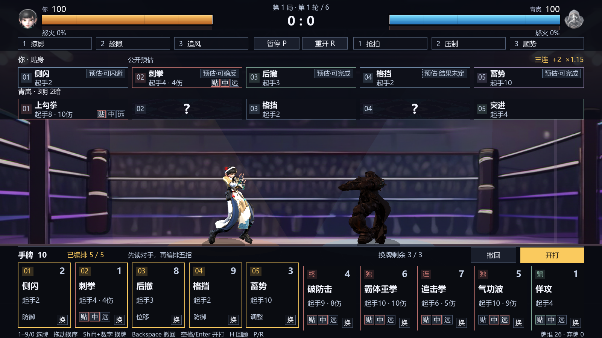
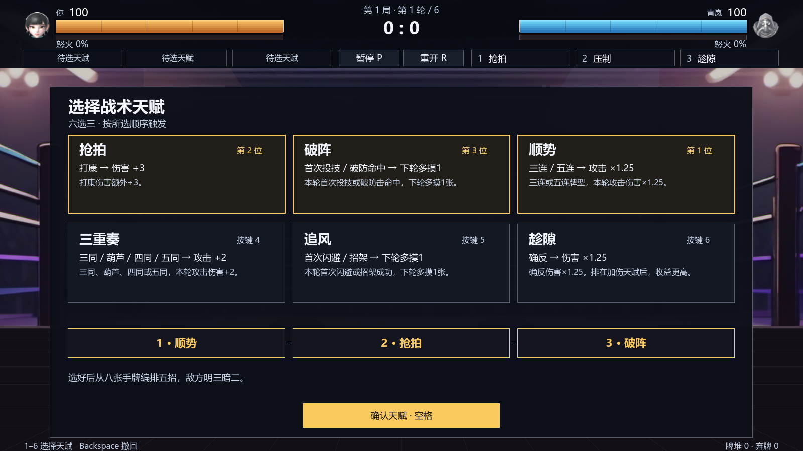
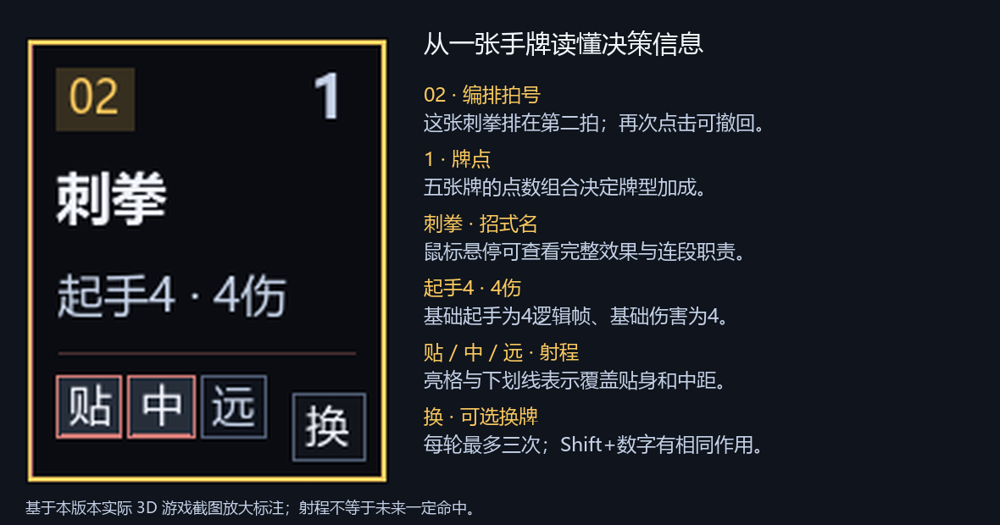
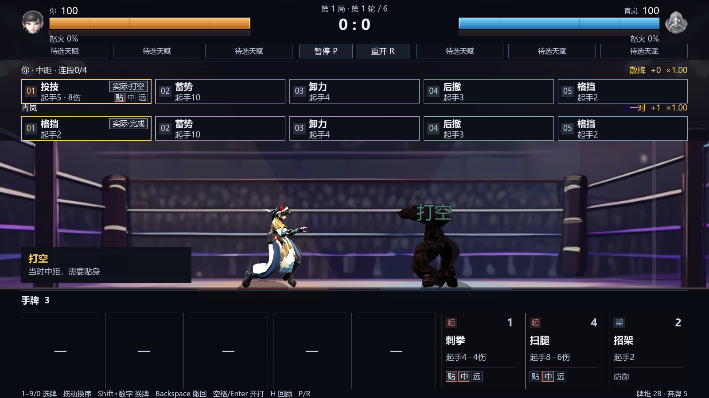
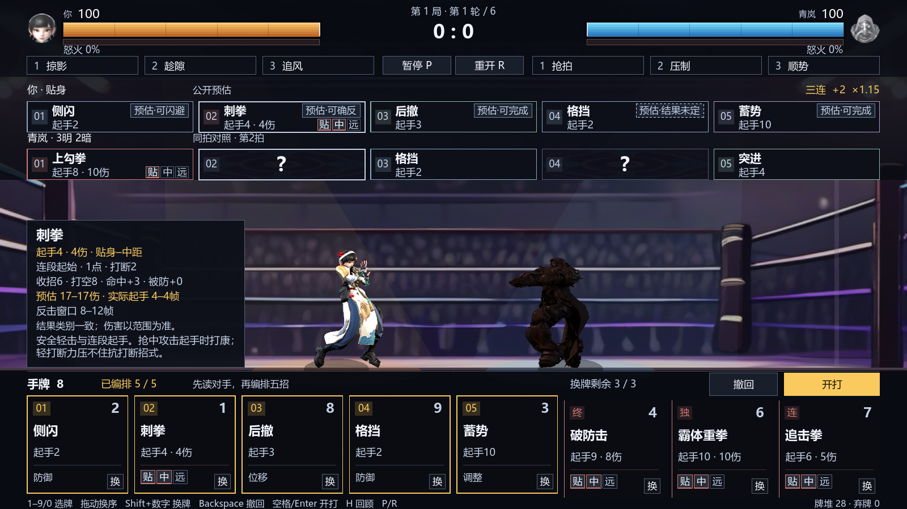
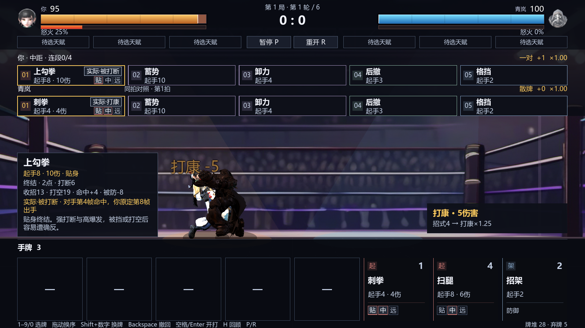
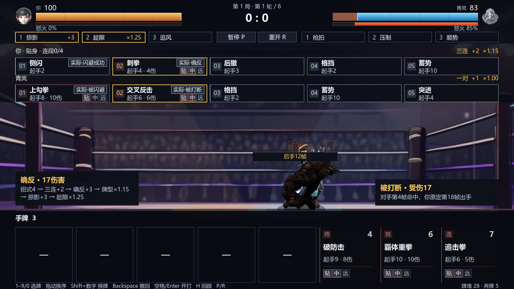
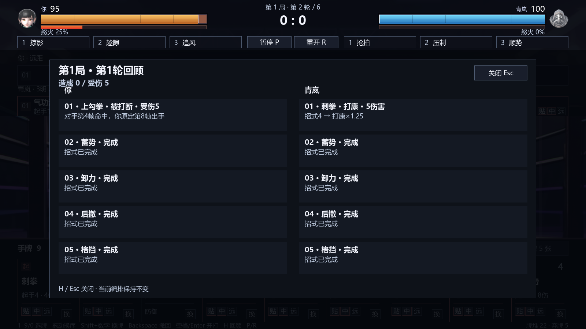

# 牌拳 / CardBoxer

**牌序决定攻防，牌型与天赋放大收益。** CardBoxer 是使用原生 3D 角色的回合制卡牌格斗游戏：从八张手牌编排五拍，读对手三张明牌，在两张暗牌带来的变化中争取先手、闪避确反和连段。

[下载 Windows 游戏](https://github.com/tutict/CardBoxer/releases/latest) · [完整规则](CardBoxer/README.md) · [界面优化记录](docs/ui/2026-11-22-ui-implementation.md)



以下图片来自本版本游戏的实际 3D 渲染；牌面说明图使用真实手牌截图放大标注。

## 下载后直接玩

Windows 10/11 64 位用户可以在 [Releases](https://github.com/tutict/CardBoxer/releases/latest) 下载：

| 文件 | 用途 |
|---|---|
| `CardBoxer-v0.1.0-windows-x64.exe` | 独立游戏，双击启动，无需安装 Godot |
| `CardBoxer-v0.1.0-windows-x64.zip` | 同一游戏 EXE，附快速操作说明与 Godot 许可 |
| `SHA256SUMS.txt` | 校验 EXE 和 ZIP 的下载完整性 |

默认打开战术模式，并最大化窗口。整个界面使用等比缩放，支持鼠标与键盘。

## 第一步：选择三项天赋

开局从六项天赋里选择三项，**选择次序就是触发次序**。点击或按 `1–6` 选择，再次点击取消，`Backspace` 撤回最后一项；选满三项后按空格确认。



天赋会贯穿整场三局。例如“抢拍”强化打康，“顺势”强化三连或五连牌型，“追风”在首次闪避或招架成功后让下一轮多摸一张。伤害先加值再乘倍率，因此天赋的排列会影响收益。完整效果可以直接在选择页阅读，也能在战斗中悬停顶部天赋查看。

## 第二步：读招式、起手和射程

编排页上方两行分别是你和对手的五拍。同一列对应同一拍；悬停任一计划槽时，上下同列一起描边，方便比较双方动作。

对手先锁定五招，编排时显示 **三张实际明牌、两张问号暗牌**。你选牌、换牌或拖动换序都不会让对手重新决定；确认开打后才揭开暗牌。



| 牌面信息 | 怎样使用 |
|---|---|
| 左上小标 / 编排拍号 | 未选中时表示连段职责或动作类别；选中后表示第几拍执行 |
| 右上牌点 | 五张牌的点数组合决定牌型加成 |
| 招式名 | 区分刺拳、上勾拳、侧闪、格挡等动作 |
| 起手 / 伤害 | 显示基础起手帧数与基础伤害；最终伤害还受牌型、天赋和防御影响 |
| 贴 / 中 / 远 | 亮底和下划线表示覆盖距离；三格文字始终可读 |
| “换”按钮 | 同页换掉一张手牌，每轮最多三次；换掉已编排的牌会撤回这一张 |

起手帧数描述出招时间，连段起始描述招式职责。悬停详情会补充收招、打空恢复、打断力、抗打断与完整效果。

当前距离分为贴身、中距和远距。投技、上勾拳只打贴身；扫腿只打中距；气功波打中距和远距。突进接近一档，后撤拉开一档，扫腿命中也会推远，所以安排在前面的移动会改变后续攻击能否够到。



## 第三步：编排五招，判断风险

从八张手牌按顺序选五张。选择后，手牌抬升并显示拍号；点击我方计划槽可以撤回该张，拖动计划槽可以换序。最多十张手牌仍能完整显示在同一页。

选满五张后，每拍出现独立的“预估”标签：

- **实线标签**：所有合法公开补全的结果类别一致，伤害仍以详情范围为准。
- **虚线标签**：结果可能受暗牌或前拍影响，例如距离风险、结果未定。
- **预估中 / 暂不可用**：可以继续改序或直接开打，不会保留旧的预估标签。



预估只使用公开信息，不提供暗牌身份或命中百分比。完整计划才会预测，部分计划只显示动作信息。

五张牌计算最强牌型，换序保持牌型，出招顺序影响每拍攻防。三连可由五张中连续三点组成，五连要求五点连续。牌型给攻击提供平加与倍率，胜负仍由真实交锋和剩余血量决定。

## 第四步：开打，看懂为什么命中或失败

按空格、Enter 或“开打”确认。双方逐拍执行，当前拍会同时高亮；原槽里的标签改为真实的命中、被格挡、打空、被打断或完成。尚未执行的拍不会提前显示结果。

快招抢中对手已经开始的攻击起手会形成打康；达到打断条件时会取消对方攻击。攻击赶上对手的等待窗口且距离满足时，可以形成确反。侧闪和招架都有起手完成后的九帧窗口，防御太早也可能被延迟攻击抓住。



例如 `侧闪 → 刺拳 → 后撤 → 格挡 → 蓄势` 配 `掠影 → 趁隙 → 追风`：侧闪成功后，刺拳及时赶上对手的反击窗口，结合三连牌型与天赋可以打出确反；后撤、格挡和蓄势为后续交锋准备。



战斗两侧的反馈会解释“当时中距，需要贴身”“对手第4帧命中，你原定第8帧出手”“闪避窗口已结束”等具体原因。悬停一侧详情时，另一侧已执行反馈仍保留。

## 第五步：回顾上一轮，再调整牌序

每轮交锋结束后，出过的牌进入弃牌堆并补充手牌。默认下一轮八张，摸牌天赋与成功格挡等效果可以增加到最多十张；牌堆耗尽后洗回弃牌。

操作条保留上轮造成与受到的伤害。按 `H` 或点击“回顾”，可以重新查看双方五拍的结果与关键原因。



回顾期间当前编排保持原样，比赛时间停止推进；按 `H`、`Esc` 或关闭按钮返回继续选牌。重开后会清空旧回顾。

一场三局两胜，每局从100 HP开始，最多六轮。KO或六轮结束后判局胜负；平血或双KO记局平，三局后胜局相同记场平。天赋与怒火跨局保留，怒火满100后下一轮获得EX牌型加成。

## 操作速查

| 操作 | 作用 |
|---|---|
| 鼠标 / `1–9`、`0` | 选牌、取消；`0` 对应第十张 |
| `1–6` | 开局选择天赋 |
| 手牌“换” / `Shift+数字` | 可选换牌，每轮最多三次 |
| 点击已编排槽 / `Backspace` | 撤回指定牌 / 最后一张 |
| 拖动我方计划槽 | 改变顺序；拖出计划区取消拖动 |
| 空格 / Enter / 开打 | 确认天赋或五张计划 |
| `H` / 回顾；`Esc` / 关闭 | 查看上一轮；返回当前计划 |
| `P` / 暂停 | 暂停、继续 |
| `R` / 重开 | 重新构筑一场 |
| 悬停明牌、手牌或天赋 | 查看完整效果与时序详情 |

## 从源码运行与开发

仓库的模型、动画和研发素材使用 [Git LFS](https://git-lfs.com/)。克隆前安装 Git LFS：

```shell
git lfs install
git clone https://github.com/tutict/CardBoxer.git
```

安装 Godot 4.5 或更新的 Godot 4 后，双击根目录 [play.bat](play.bat) 启动战术模式。也可以打开 [CardBoxer/project.godot](CardBoxer/project.godot)。启动器支持引擎放在游戏目录、PATH，或通过 `CARD_BOXER_GODOT` 指定完整路径。

其他模式入口是 `CardBoxer/play-classic.bat`（传统三张比牌）和 `CardBoxer/play-realtime.bat`（实时格斗），同样使用原生3D角色。独立EXE也可通过 `CARD_BOXER_BATTLE_MODE=taikou|realtime` 选择对应模式。

设置 `CARD_BOXER_UI_MOTION=0` 可减少短暂的界面动态反馈；选中编号、描边和静态抬升仍保留。

```powershell
# 完整游戏回归（27项脚本）
py -3 CardBoxer/tools/verify_tactical.py --godot "C:/path/to/godot_console.exe"

# 安装对应引擎版本的 Windows 导出模板后，打包独立EXE和ZIP
./CardBoxer/tools/package_windows.ps1 -GodotPath "C:/path/to/godot_console.exe"
```

打包脚本也支持 `-TemplatePath` 指定对应版本的 Windows release 模板，默认输出到 `dist/windows/`。它会自动检查导出日志，并验证打包后的战术、传统和实时模式均能加载双方原生3D模型。

## 工程与研发资料

- [CardBoxer](CardBoxer/README.md)：游戏主工程、完整规则、测试与打包脚本。
- `CardBoxer-bake/`：建模、动作烘焙、原生骨骼接线、视觉对照和实验资料。
- [界面参考调研](docs/ui/2026-11-22-ui-reference-research.md)与[优化方案](docs/superpowers/plans/2026-11-22-ui-optimization-plan.md)：本次界面改动的来源与约束。
- [英文路径迁移](docs/path-renames.json)与[3D清理记录](docs/3d-cleanup.json)：目录迁移和历史2D专用文件清理。

目录和文件名使用英文，游戏文字保留中文。研发工具中的历史本机绝对路径需要按环境调整；Godot/Python缓存、临时日志、打包产物、Blender自动备份与递归发布副本不提交。

游戏使用的 Godot Engine 许可见 [GODOT_LICENSE.txt](CardBoxer/GODOT_LICENSE.txt)。
