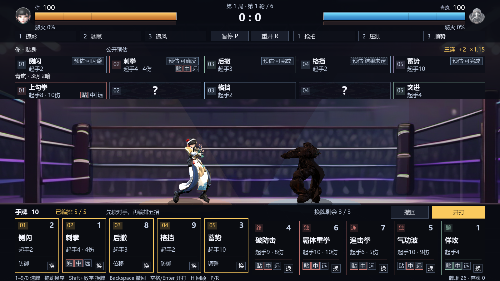
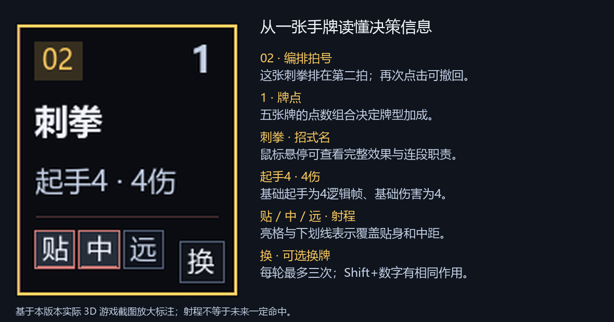
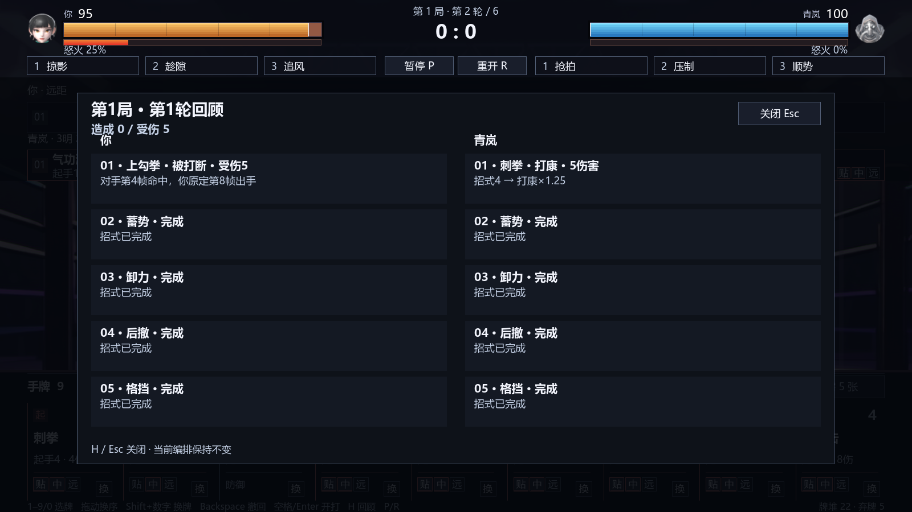

# CardBoxer 界面优化实施记录

日期：2026-11-22。本记录对应[界面参考调研](2026-11-22-ui-reference-research.md)和[界面优化方案](../superpowers/plans/2026-11-22-ui-optimization-plan.md)。

## 实施内容

- 保留 Godot 原生 3D 擂台与低饱和深色视觉，顶部状态区收至 136px，双方五拍对齐并保留 54px 卡槽。
- 十张 172px 手牌同页展示。牌面分别显示动作类别或拍号、牌点、招式、起手与伤害，以及带文字的三格射程。常规换牌按钮采用中性色，并留出不会遮挡操作条的命中区域。
- 计划槽将招式、关键数值、射程与结果分区。预测标签明确显示“预估”；结果只显示已经执行的反馈。实线与虚线标出结果类别一致和不确定。等待与错误状态不会继续显示旧预测。
- 悬停一侧战斗详情时，另一侧的实际反馈继续可见。交锋完成后，将上一轮冻结为独立深拷贝，通过 `H` 或按钮回顾双方五拍的招式、结果和原因。查看时暂停比赛时间，并拦截选牌、换牌、撤回、确认和拖动。`Esc` 与关闭按钮返回，重开会清空回顾。
- 天赋摘要采用目录中的真实效果说明触发条件和收益，完整原文继续可查看；明确标示选择次序。战斗中只强调实际触发的天赋。
- 增加短暂的选中边框反馈。设置 `CARD_BOXER_UI_MOTION=0` 后关闭该反馈，选中编号、描边和静态抬升保留。
- 根目录 README 增加选择天赋、读牌、预估、五拍交锋、回顾和操作说明，并配有真实游戏截图与放大牌面解读图。增加 Windows 导出预设、自动打包脚本和 Godot MIT 许可文件。

## 已观察到的验证

| 检查 | 结果 |
|---|---|
| 原 tactical UI 基线 | 240/240 检查通过 |
| 新 HUD 行为回归 | 251/251 检查通过。覆盖射程格、十张手牌的命中区域、18 种动作目录、公开预估、暗牌屏蔽、回顾只读副本、回顾期间的键鼠拦截，以及关闭和重开 |
| 原 UI 与反馈回归 | UI 检查 240/240 通过，反馈检查 38/38 通过 |
| 完整 Godot 回归 | 27/27 脚本通过。包括双方 3D 模型启动、战术、传统比牌、实时格斗、战斗反馈、预测和重绘 |
| GPU 界面捕获 | 41 个实际画面；Godot 日志确认双方加载原生 3D 角色和 13 根骨骼 |
| 十张牌布局 | 1280×720、1600×900、1920×1080、2560×1440 四种 16:9 画布均完整显示十张手牌。计划和回顾各通过四个分辨率的截图检查 |
| 1600×1000 请求 | Godot 窗口接受了 1600×1000。这个固定 1600×900 根视口的截取图只取到内容区，没有验证上下留边的实际渲染 |
| 1080p 中文字形 | 计划数值、手牌数值和射程标签测得字形主体高度分别为 21px、21px、20px |
| 动作详情换行 | 18 种动作说明都通过现有中文换行检查。GPU 详情面板最大高度为 260 个逻辑像素 |
| Windows x64 导出 | `CardBoxer-v0.1.0-windows-x64.exe` 为 175,525,608 字节，PCK 已内嵌。ZIP 为 109,580,834 字节，附快速说明和许可证 |
| 发布包模式启动 | 同一个独立 EXE 分别以 `tactical`、`taikou`、`realtime` 环境启动，三次均加载双方原生 3D 角色 |

Godot 日志将 Windows 根证书读取诊断保留，并由项目验证脚本忽略这一环境诊断。测试、导出和三个模式启动均没有发现其他引擎错误。

## 仍待检查

- Godot 主窗口接受 1600×1000，但导出的固定根视口截图为 1600×900。这些截图没有覆盖 16:10 留边的屏幕呈现或窗口坐标下鼠标命中区域。
- 高对比度系统模式和真人试玩尚未检查。
- GitHub Release 发布后，需要从 GitHub 下载发布文件并回读 SHA-256 校验。

## 界面示例

